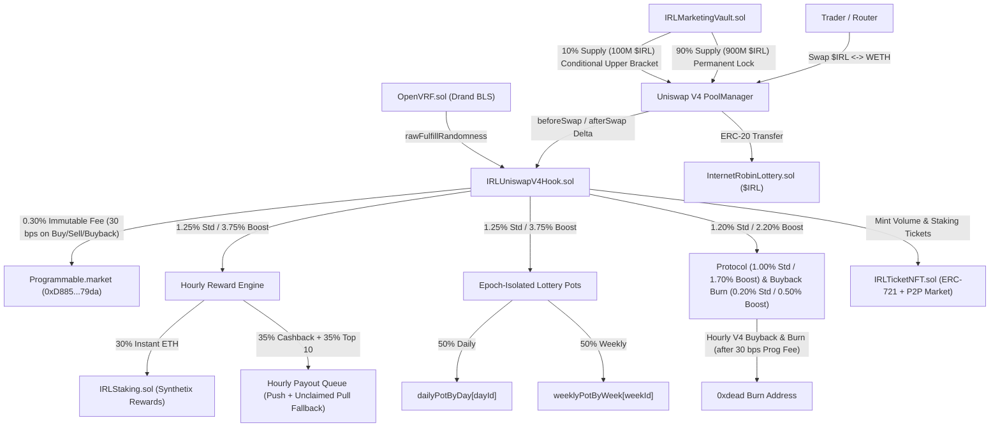

# Internet Robinhood Lottery ($IRL) — System Architecture & Technical Specification

> **Network:** Robinhood Chain Mainnet (`Chain ID: 4663`)  
> **AMM Layer:** Uniswap V4 (`PoolManager: 0x8366a39CC670B4001A1121B8F6A443A643e40951`)  
> **Launchpad Infrastructure:** Programmable.market (`0xD88539d3c4C460136a733A3Fd60cf6BF269079da`)  
> **Randomness Engine:** Native OpenVRF Router (Drand `evmnet` BLS12-381 On-Chain Verification)

---

## 1. Architectural Overview

**Internet Robinhood Lottery ($IRL)** is a sovereign reward, lottery, and deflationary ecosystem built natively into a custom **Uniswap V4 Hook** (`IRLUniswapV4Hook.sol`) on Robinhood Chain. Every swap on the `$IRL / WETH` Uniswap V4 pool is intercepted at the `PoolManager` hook layer (`beforeSwap` and `afterSwap` with delta returns), extracting a bounded WETH fee and distributing native ETH rewards across four autonomous engines without requiring users to claim tokens or pay inflation:

1. **Hourly Reward Engine:** Distributes native ETH every 60 minutes across Top 10 volume traders (`35%`), active swapper cashback (`35%`), and real-time `$IRL` staker yield (`30%`).
2. **Epoch-Isolated Dual Lottery Engine:** Routes `50%` to the Daily 24h Jackpot (`dailyPotByDay[dayId]`) and `50%` to the Sunday Mega-Jackpot (`weeklyPotByWeek[weekId]`), drawn via **OpenVRF** over ERC-721 lottery tickets (`IRLTicketNFT.sol`) minted automatically from trading volume and staking.
3. **Automated Hourly V4 Buyback & Burn Engine (`0.50%` Boost $\rightarrow$ `0.20%` Standard):** Reserves **`0.50%` (`50 bps`)** of every swap during Launch Boost and **`0.20%` (`20 bps`)** during Standard Tax in `buybackPot`. Once per hour (`executeBuybackAndBurn`), the Hook deducts the `0.30%` (`30 bps`) Programmable platform fee once and swaps the remaining `99.70%` `WETH` into `$IRL` on the Uniswap V4 pool, taking the purchased `$IRL` directly to `0x000000000000000000000000000000000000dEaD`.
4. **Immutable Launchpad Routing:** Hardcodes a `0.30%` (`30 bps`) platform fee once on every normal buy, normal sell, and internal buyback directly to Programmable.market (`0xD88539d3c4C460136a733A3Fd60cf6BF269079da`).

---

## 2. Smart Contract Modules

| Contract | Source File | Responsibility |
| :--- | :--- | :--- |
| **`InternetRobinLottery`** | `src/InternetRobinLottery.sol` | Fixed-supply ERC-20 (`1,000,000,000 $IRL`, `18` decimals, zero external mints, `0%` transfer tax). |
| **`IRLUniswapV4Hook`** | `src/IRLUniswapV4Hook.sol` | Core Uniswap V4 Hook (`BEFORE_SWAP_FLAG \| AFTER_SWAP_FLAG \| BEFORE_SWAP_RETURNS_DELTA_FLAG \| AFTER_SWAP_RETURNS_DELTA_FLAG`). Manages bounded swap fees, fixed launch-price cutoffs, anti-whale limits, hourly rewards, epoch-isolated lottery pots, OpenVRF callbacks, and `0.50% / 0.20%` hourly batched V4 buyback-and-burn. |
| **`IRLMarketingVault`** | `src/IRLMarketingVault.sol` | Liquidity custody and single-sided LP vault. Holds and seeds `100%` of the initial `$IRL` supply into `PoolManager` during the atomic launch as two verifiable positions: `90%` (`900M $IRL`) permanently locked forever and `10%` (`100M $IRL`) conditionally locked in an upper marketing bracket. |
| **`IRLTicketNFT`** | `src/IRLTicketNFT.sol` | ERC-721 lottery ticket contract with an integrated zero-escrow P2P secondary marketplace (`2%` sale tax routed back into the active lottery pots) and on-chain weekly holding caps (`42` to `70` tickets/week depending on staked `$IRL`). |
| **`IRLStaking`** | `src/IRLStaking.sol` | Non-custodial `$IRL` staking pool streaming real-time native ETH dividends (`accEthPerShare` Synthetix pattern), up to `+50%` hourly leaderboard score multiplier, raised daily ticket caps (`6` $\rightarrow$ `10`/day), and up to `10` free lottery tickets every 4 days. |
| **`OpenVRF`** | `lib/openvrf/src/OpenVRF.sol` | Permissionless Drand `evmnet` BLS12-381 randomness verifier (`CHAIN_HASH = 0x04f1e906...`). Verifies round signatures on-chain and delivers tamper-proof randomness to `IRLUniswapV4Hook.rawFulfillRandomness`. |

---

## 3. Bounded Two-Phase Fee Schedule & Launch Window

### 3.1 One-Time Non-Resettable Launch Window & Fixed Launch-Price Cutoffs
- `launchTimestamp` is initialized exactly once (either explicitly via `launch()` during atomic deployment or automatically on the first swap) and **cannot be reset or modified** by the owner (`require(launchTimestamp == 0, "AlreadyLaunched")`).
- `disableAntiWhaleSqrtPrice` (`$50,000 MC`) and `disableLaunchTaxSqrtPrice` (`$100,000 MC`) are initialized **once** via `setDisableAntiWhaleFromInitialPrice` (`require(disableAntiWhaleSqrtPrice == 0 && disableLaunchTaxSqrtPrice == 0, "CutoffsAlreadyInitialized")`) and **cannot be modified after initialization**.
- There is **no punitive anti-snipe tax** and **no wallet whitelist**. All swaps are subject to clearly bounded fees (`10.00%` during the initial Launch Boost window, then `4.00%` permanently).
- **Dual Cutoff for Launch Boost (`10.00%` $\rightarrow$ `4.00%`):**
  1. **Fixed Time Expiry (`LAUNCH_TAX_DURATION = 24 hours`):** `isLaunchTaxActive()` automatically returns `false` once `block.timestamp >= launchTimestamp + 24 hours`, and the next swap permanently sets `launchTaxEnabled = false`.
  2. **Fixed Market Cap Cutoff (`$100,000 MC`):** Configured once at launch via `disableLaunchTaxSqrtPrice` (`5.0x` initial `$20k` Market Cap price, i.e., $\sqrt{5} \approx 2.2360679775\times$ initial `sqrtPriceX96`). As soon as the pool `sqrtPriceX96` crosses this threshold, `_checkLaunchTaxCutoff` permanently sets `launchTaxEnabled = false`.
  3. **One-Way Manual Lowering:** The owner can call `disableLaunchTax()` or `removeLimits()` to drop the tax to `4.00%` early, but **can never re-enable** `launchTaxEnabled`.

### 3.2 Complete Fee Allocation Table (Basis Points per Swap)

| Destination / Engine | Launch Boost Phase (`10.00%` / `1000 bps`) *(First `24h` OR until `$100k MC`)* | Standard Cruise Phase (`4.00%` / `400 bps`) *(Permanent after `24h` or `$100k MC`)* | Sub-Allocation Mechanics |
| :--- | :---: | :---: | :--- |
| **1. Programmable.market Platform Fee** | **`0.30%`** (`30 bps`) | **`0.30%`** (`30 bps`) | Hardcoded `constant PROGRAMMABLE_FEE_RECIPIENT = 0xD88539d3c4C460136a733A3Fd60cf6BF269079da`, charged once on normal buys, normal sells, and internal buybacks without double-charging. |
| **2. Hourly Reward Pot** | **`3.75%`** (`375 bps`) | **`1.25%`** (`125 bps`) | • **35%** (`1.3125%` / `0.4375%`) $\rightarrow$ Top 10 Hourly Traders Leaderboard • **35%** (`1.3125%` / `0.4375%`) $\rightarrow$ Active Swappers Hourly Cashback • **30%** (`1.1250%` / `0.3750%`) $\rightarrow$ Instant ETH Real Yield to `$IRL` Stakers |
| **3. Dual Lottery Engine** | **`3.75%`** (`375 bps`) | **`1.25%`** (`125 bps`) | • **50%** (`1.875%` / `0.625%`) $\rightarrow$ `dailyPotByDay[currentDay]` (24h Draw) • **50%** (`1.875%` / `0.625%`) $\rightarrow$ `weeklyPotByWeek[currentWeek]` (Sunday Draw) |
| **4. Protocol & Deflation Pot** | **`2.20%`** (`220 bps`) | **`1.20%`** (`120 bps`) | • **`1.70%` (Boost) / `1.00%` (Standard)** $\rightarrow$ `protocolPot` (Keeper Gas, VRF & Marketing) • **`0.50%` (Boost) / `0.20%` (Standard)** $\rightarrow$ `buybackPot` (Hourly V4 Buyback & Burn to `0xdead`) |
| **Total Swap Tax** | **`10.00%`** (`1000 bps`) | **`4.00%`** (`400 bps`) | **`0.50%` (Boost) / `0.20%` (Standard) accumulated in `buybackPot`, paying `30 bps` Programmable fee once and burning purchased `$IRL` to `0xdead` every hour.** |

---

## 4. Verifiable Liquidity Custody & Atomic Launch Flow (`IRLMarketingVault.sol`)

During the atomic launch transaction executed by Programmable.market's executor (`0xe21827818Fea1F14d59929CAE36a93c0B44e0aE1`):

1. **Full Supply Funding (`1,000,000,000 $IRL`):** `100%` of the total `$IRL` supply is transferred into `IRLMarketingVault` (`0%` transfer tax).
2. **Dual-Position Liquidity Seeding (`seedInitialLiquidity(PoolKey)`):**
   `IRLMarketingVault` unlocks `PoolManager` and mints two distinct, verifiable concentrated liquidity positions using dedicated salts:
   - **Position 1 — Permanently Locked Core Liquidity (`PERMANENT_LOCKED_SALT = keccak256("IRL_PERMANENT_LOCKED_LP_V1")`):**
     - **Allocation:** `900,000,000 $IRL` (`90%` of total supply).
     - **Range:** Full single-sided upward price curve `[permTickLower, permTickUpper]` starting at the initial `$20,000` Market Cap tick.
     - **Custody Guarantee:** `IRLMarketingVault` contains **zero function** to decrease or withdraw `PERMANENT_LOCKED_SALT` liquidity. The principal is permanently and irreversibly locked inside Uniswap V4 `PoolManager` forever.
   - **Position 2 — Conditionally Locked Marketing Vault (`MARKETING_VAULT_SALT = keccak256("IRL_MARKETING_VAULT_LP_V1")`):**
     - **Allocation:** `100,000,000 $IRL` (`10%` of total supply).
     - **Range:** Upper marketing bracket `[marketingTickLower, marketingTickUpper]` (`24,000` to `48,000` ticks above initial launch price).
     - **Custody Guarantee:** `decreaseMarketingLiquidity(uint128 liquidityToRemove, address recipient)` enforces on-chain via `StateLibrary.getSlot0` that `currentTick` has **completely crossed** the marketing bracket (`currentTick >= marketingTickUpper` when `$IRL` is `currency0`, or `currentTick <= marketingTickLower` when `$IRL` is `currency1`). Consequently, the position can **never** be withdrawn as `$IRL` tokens to dump on the pool; it can only be withdrawn after market demand has organically converted `100%` of the bracket into `WETH`.
3. **Atomic Initial Buy (`executeInitialBuy{value: 0.15 ether}`):**
   Immediately after liquidity seeding in the same atomic launch plan, `0.15 ETH` (`150000000000000000` wei) is wrapped into `WETH` and swapped through `PoolManager` for `~16,251,704 $IRL` (`~1.625%` of supply, verified against the `2.0%` `MAX_WALLET_AMOUNT` buy cap), delivering the purchased `$IRL` to the controller while routing the `0.30%` Programmable fee (`0.00045 ETH`) directly to `0xD88539d3c4C460136a733A3Fd60cf6BF269079da`.

---

## 5. Reward Accounting & Epoch-Isolated Lottery Pots

### 5.1 Unpaid Rewards Remain Claimable by Rightful Recipients (`unclaimedRewards`)
- If a native ETH transfer fails during hourly reward distribution (`_processQueueBatch`) or lottery jackpot fulfillment (`_fulfillRandomness`) — for instance, if the winner is a smart contract wallet whose `receive()` reverts or exceeds the `50,000` gas stipend — the unpaid amount is **never** moved into `protocolPot`.
- Instead, the exact unpaid amount is credited to `unclaimedRewards[recipient]` and emits `UnclaimedRewardRecorded(recipient, amount)`.
- The rightful recipient can claim their pending ETH at any time via `claimUnclaimedRewards()` (`nonReentrant`), which zeroes `unclaimedRewards[msg.sender]` and transfers the ETH to `msg.sender`.

### 5.2 Epoch-Isolated Daily & Weekly Lottery Pots (`dailyPotByDay` & `weeklyPotByWeek`)
- Swap fees and secondary NFT marketplace taxes (`receiveMarketplaceTax`) are credited directly to the active epoch's mapping:
  - `dailyPotByDay[currentDay]` (`currentDay = block.timestamp / 1 days`)
  - `weeklyPotByWeek[currentWeek]` (`currentWeek = (block.timestamp + 3 days) / 7 days`, aligned to Sunday 23:59:59 UTC)
- When the keeper triggers `performUpkeep` for a finished day (`actionType == 3`) or week (`actionType == 4`), `_triggerLotteryDraw(targetPeriod, drawType)` snapshots **only** `dailyPotByDay[targetDay]` or `weeklyPotByWeek[targetWeek]`:
  - Even if keeper execution is delayed into the next day or week after new swaps have already occurred, prize funds accumulated in `currentDay` / `currentWeek` are **never** mixed with the historical ticket range `[dayStartTicketId[targetDay], dayEndTicketId[targetDay]]`.
  - If a past day had zero tickets minted (`dayStartTicketId[targetDay] == 0`), its pot rolls forward cleanly into the next day (`dailyPotByDay[targetDay + 1]`) or into `weeklyPotByWeek` if no tickets existed at draw time.

---

## 6. Anti-Whale Protection (`< $50,000 Market Cap`)

To guarantee fair token distribution during initial price discovery (`< $50,000` Market Cap):
- **Max Swap Size (`MAX_TX_AMOUNT`):** `10,000,000 $IRL` (`1.0%` of total supply) per buy or sell transaction (with the atomic launch buy at `block.timestamp == launchTimestamp && trader == owner()` permitted up to `MAX_WALLET_AMOUNT`).
- **Max Wallet Holding on Buys (`MAX_WALLET_AMOUNT`):** `20,000,000 $IRL` (`2.0%` of total supply). In Uniswap V4 `BalanceDelta`, bought `$IRL` is positive (`irlDelta > 0`) and sold `$IRL` paid into the pool is negative (`irlDelta < 0`). Because `_afterSwap` runs before router settlement/take, `balanceOf(trader)` is the pre-swap balance; `_enforceAntiWhale` checks `IERC20(irlTokenAddr).balanceOf(trader) + tokenAmount <= MAX_WALLET_AMOUNT` strictly when `irlDelta > 0` (buys), ensuring an ordinary holder at the `2.0%` boundary can always sell freely through the router.
- **Automatic Permanent Deactivation at Fixed `$50,000 Market Cap`:** Configured once at launch via `disableAntiWhaleSqrtPrice` (`2.5x` initial `$20k` MC price, i.e., $\sqrt{2.5} \approx 1.58113883\times$ initial `sqrtPriceX96`). Once crossed, `limitsEnabled` permanently flips to `false` on-chain (`emit LimitsDisabled()`).